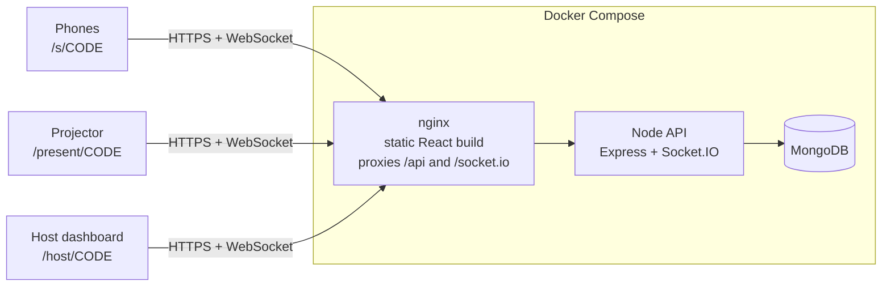

# Rallie

Live polls and audience Q&A that you host yourself. The host creates a session and gets a join code and QR code. Anyone scans it on their phone, votes and asks questions with no app and no account, and the results move on the big screen as votes arrive.

<!-- Add a screenshot or GIF here: docs/demo.gif -->

**Try it:** `docker compose up --build`, then open <http://localhost:8080> and press **Sign in as demo host**. The seeded session `DEMO42` has polls, votes and questions already in it.

## What it does

- **Live polls.** Single or multiple choice. One poll is open at a time. Every phone and the projector see each vote land.
- **Audience Q&A.** Anonymous or named questions. Upvotes push the best ones to the top and the host marks them answered.
- **Three screens.** Host dashboard (`/host/:code`), participant phone view (`/s/:code`) and a projector view (`/present/:code`).
- **Join by QR or code.** The host can set the address phones should open (LAN IP or public tunnel URL) and the QR code updates immediately.
- **Dark mode, responsive layouts, reduced-motion support.**

## Stack

| Layer | Tech |
|---|---|
| Frontend | React 18, TypeScript, Vite, React Router, hand-written CSS (no UI kit) |
| Realtime | Socket.IO (WebSocket with HTTP fallback) |
| Backend | Node 22, Express, TypeScript, Zod validation, JWT, bcrypt, Helmet, express-rate-limit |
| Database | MongoDB 7 with Mongoose |
| Delivery | Docker Compose (MongoDB, API, nginx serving the built app), GitHub Actions CI |
| Tests | Vitest and Supertest against an in-memory MongoDB |

## Architecture



The browser only ever talks to one origin, so there is no CORS to configure and only one port to expose. In development, Vite's dev server plays the role nginx plays in production.

### Data model

| Collection | Key fields |
|---|---|
| `users` | name, email (unique), bcrypt password hash |
| `sessions` | host, title, 6 character `code` (unique), status `live` or `ended` |
| `polls` | session, question, type `single` or `multiple`, options, status `draft`, `open` or `closed` |
| `votes` | poll, voterId, choices. **Unique index on `{poll, voterId}`** |
| `questions` | session, text, authorName, authorId, upvotes, upvoters, answered |

## Design decisions

These are the choices worth discussing.

- **One vote per participant is enforced by the database.** The unique `{poll, voterId}` index means two simultaneous requests cannot both succeed. The second insert fails with a duplicate key error and the API answers `409`. There is a test that fires many votes at once from the same participant and checks that exactly one is counted.
- **Anonymous participants get a signed identity.** Joining mints a random voter id and signs it, together with the session code, into a JWT stored in the browser. The token cannot be reused in another session, and a refresh keeps the same identity so a person cannot vote twice by reloading.
- **Upvotes are atomic.** Each toggle is a single `findOneAndUpdate` guarded by whether the voter is already in the `upvoters` array, so double taps and two devices cannot double count or push the counter below zero.
- **Results are computed in the database and throttled.** A single aggregation (`$match`, then `$facet` with a per-poll voter count and a per-option `$unwind` and `$group`) tallies the votes. When many people vote in the same moment, a 150 ms trailing throttle runs it and broadcasts once per window, always with the newest tally, instead of once per vote.
- **Snapshot, then patch.** The client loads the full session over HTTP, then applies Socket.IO events as small patches. After a reconnect it fetches the snapshot again, so a flaky connection cannot leave a screen permanently out of date.
- **One open poll at a time.** Opening a poll closes the others, so "the current poll" is never ambiguous on the projector or on phones.
- **Drafts stay private.** Draft polls are broadcast to the host's private room only and are filtered out of public snapshots.
- **Rate limits match how audiences connect.** Voting, asking and upvoting are limited per participant token, not per IP, because a whole room often shares one Wi-Fi address. Login and join are limited per IP.
- **Routes know almost nothing about Socket.IO.** They call a tiny `Realtime.emit` interface. Tests swap in a recorder, which keeps the HTTP layer easy to test.
- **Validation at the edge.** Every request body is parsed with a Zod schema before it reaches a handler.

## Run it

### With Docker (recommended)

```bash
cp .env.example .env          # optional, but set JWT_SECRET: openssl rand -hex 32
docker compose up --build
```

Open <http://localhost:8080>. Set `PORT` in `.env` to use a different port. Set `SEED_DEMO=false` to skip the demo data.

### For development

```bash
docker run -d --name rallie-mongo -p 27017:27017 mongo:7

cd server && npm install && npm run dev     # API on :4000
cd client && npm install && npm run dev     # app on :5173, proxies /api and /socket.io to :4000
```

Open <http://localhost:5173>. Set `SEED_DEMO=true` in the server's environment to load the demo session.

### Tests and checks

```bash
cd server && npm test && npm run typecheck
cd client && npm run typecheck && npm run build
```

The server tests download a MongoDB binary the first time they run, so they need internet access once.

## Putting it online for a live demo

Phones need an address they can reach. Pick one:

- **Same Wi-Fi.** Find your computer's LAN IP, open `http://<that-ip>:8080` and use **Use this address** on the host screen so the QR code points at it.
- **Public HTTPS link, no router changes.** Create a Cloudflare Tunnel in Zero Trust, point its public hostname at `http://web:80`, put the token in `.env` as `TUNNEL_TOKEN`, then run `docker compose --profile tunnel up -d`.
- **Any VPS.** Install Docker, clone the repo, set `JWT_SECRET`, run `docker compose up -d --build` and put a TLS reverse proxy such as Caddy in front of port 8080.

## API summary

All routes are under `/api`. Host routes need `Authorization: Bearer <host token>`, participant routes need the token from `join`.

| Method and path | Who | Purpose |
|---|---|---|
| `GET /health` | anyone | Liveness and database check |
| `POST /auth/register`, `POST /auth/login`, `GET /auth/me` | host | Accounts |
| `GET /sessions`, `POST /sessions` | host | List and create sessions |
| `PATCH /sessions/:code`, `DELETE /sessions/:code` | host | Rename, end or delete |
| `GET /sessions/:code` | anyone | Snapshot (hosts also see drafts, participants see their own votes) |
| `POST /sessions/:code/join` | anyone | Get an anonymous participant token |
| `POST /sessions/:code/polls` | host | Create a poll (starts as a draft) |
| `PATCH /polls/:id`, `POST /polls/:id/reset`, `DELETE /polls/:id` | host | Open or close, clear votes, delete |
| `POST /polls/:id/vote` | participant | Cast a vote |
| `POST /sessions/:code/questions` | participant | Ask a question |
| `POST /questions/:id/upvote` | participant | Toggle an upvote |
| `PATCH /questions/:id`, `DELETE /questions/:id` | host | Mark answered, remove |

Socket events sent to a session room: `poll:created`, `poll:updated`, `poll:deleted`, `poll:results`, `poll:reset`, `question:created`, `question:updated`, `question:deleted`, `session:updated`, `session:deleted`, `presence`.

## Project layout

```
server/src
  app.ts, index.ts, config.ts, realtime.ts, seed.ts
  models/        Mongoose schemas and indexes
  routes/        auth, sessions, polls, questions
  middleware/    auth, rate limits, Zod validation
  services/      results aggregation, lookups, join codes
server/tests     API and concurrency tests
client/src
  pages/         Landing, Auth, Dashboard, HostSession, Participant, Present
  components/    ResultBars, QuestionList, PollForm, JoinQR, Layout
  useLiveSession.ts   snapshot-then-patch state with Socket.IO
```

## Known limitations

- Participant identity is per browser. Someone who clears site data and rejoins gets a new identity and can vote again. Stopping that would need real accounts or a join PIN, which would add friction for an audience.
- Votes are final once cast. Changing a vote is not supported.
- Socket.IO runs on a single server process. Scaling out would need the Redis adapter.
- The broadcast throttle state lives in memory in the API process, so with several API instances each would throttle on its own. Fine for one server, and it would move to Redis along with the Socket.IO adapter.
